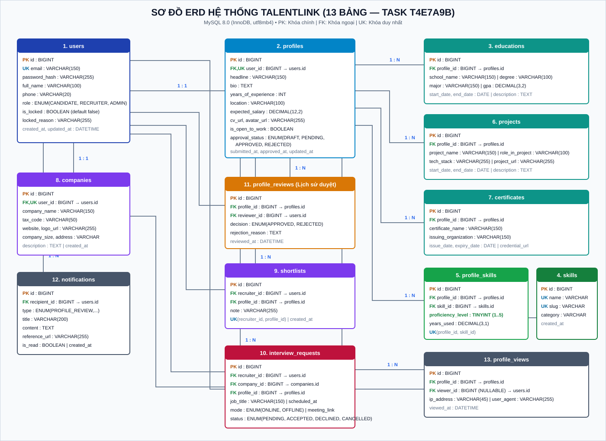

# Thiết kế Cơ sở dữ liệu (CSDL) & Sơ đồ ERD — TalentLink

**Mã Task:** `T4E7A9B`  
**Hệ quản trị CSDL:** MySQL 8.0+ (`InnoDB`, `utf8mb4_unicode_ci`)  
**Tổng số bảng:** **13 bảng** (`users`, `profiles`, `educations`, `skills`, `profile_skills`, `projects`, `certificates`, `companies`, `shortlists`, `interview_requests`, `profile_reviews`, `notifications`, `profile_views`).

> [!IMPORTANT]
> Tài liệu thiết kế CSDL và ERD này dùng để **Mentor review & duyệt trên Pull Request** trước khi nhóm tiến hành viết script Flyway Migration (`V2__...sql`).

---

## 1. Sơ đồ ERD (Entity Relationship Diagram)

### 1.1. Bản vẽ ERD tổng thể (Vector SVG)

### 1.2. Sơ đồ ERD tương tác (Mermaid `erDiagram`)

```mermaid
erDiagram
    users ||--o| profiles : "1:1 sở hữu hồ sơ"
    users ||--o| companies : "1:1 đại diện công ty"
    users ||--o{ notifications : "1:N nhận thông báo"
    users ||--o{ shortlists : "1:N lưu ứng viên"
    users ||--o{ interview_requests : "1:N gửi lời mời"
    users ||--o{ profile_reviews : "1:N admin xét duyệt"
    users ||--o{ profile_views : "1:N xem hồ sơ"

    profiles ||--o{ educations : "1:N học vấn"
    profiles ||--o{ projects : "1:N dự án"
    profiles ||--o{ certificates : "1:N chứng chỉ"
    profiles ||--o{ profile_skills : "1:N kỹ năng hồ sơ"
    skills ||--o{ profile_skills : "1:N danh mục kỹ năng"

    profiles ||--o{ profile_reviews : "1:N lịch sử duyệt"
    profiles ||--o{ shortlists : "1:N được lưu"
    profiles ||--o{ interview_requests : "1:N nhận lời mời"
    companies ||--o{ interview_requests : "1:N thuộc công ty"
    profiles ||--o{ profile_views : "1:N lượt xem"

    users {
        bigint id PK
        varchar email UK "NOT NULL"
        varchar password_hash "NOT NULL (BCrypt)"
        varchar full_name "NOT NULL"
        varchar phone
        varchar role "CANDIDATE | RECRUITER | ADMIN"
        boolean is_locked "DEFAULT FALSE"
        varchar locked_reason
        datetime created_at
        datetime updated_at
    }

    profiles {
        bigint id PK
        bigint user_id FK,UK "users.id"
        varchar headline "Vị trí chuyên môn"
        text bio "Giới thiệu bản thân"
        int years_of_experience "Số năm KN >= 0"
        varchar location "Khu vực làm việc"
        decimal expected_salary
        varchar cv_url
        varchar avatar_url
        boolean is_open_to_work "DEFAULT TRUE"
        varchar approval_status "DRAFT | PENDING | APPROVED | REJECTED"
        datetime submitted_at
        datetime approved_at
        datetime created_at
        datetime updated_at
    }

    educations {
        bigint id PK
        bigint profile_id FK "profiles.id"
        varchar school_name "NOT NULL"
        varchar degree
        varchar major
        decimal gpa
        date start_date
        date end_date
        text description
    }

    skills {
        bigint id PK
        varchar name UK "NOT NULL"
        varchar slug UK "NOT NULL"
        varchar category "BACKEND | FRONTEND | DB | DEVOPS..."
        datetime created_at
    }

    profile_skills {
        bigint id PK
        bigint profile_id FK "profiles.id"
        bigint skill_id FK "skills.id"
        tinyint proficiency_level "CHECK (1..5)"
        decimal years_used
    }

    projects {
        bigint id PK
        bigint profile_id FK "profiles.id"
        varchar project_name "NOT NULL"
        varchar role_in_project
        varchar tech_stack
        varchar project_url
        date start_date
        date end_date
        text description
    }

    certificates {
        bigint id PK
        bigint profile_id FK "profiles.id"
        varchar certificate_name "NOT NULL"
        varchar issuing_organization "NOT NULL"
        date issue_date
        date expiry_date
        varchar credential_url
    }

    companies {
        bigint id PK
        bigint user_id FK,UK "users.id"
        varchar company_name "NOT NULL"
        varchar tax_code
        varchar website
        varchar logo_url
        varchar company_size
        varchar address
        text description
    }

    shortlists {
        bigint id PK
        bigint recruiter_id FK "users.id"
        bigint profile_id FK "profiles.id"
        varchar note
        datetime created_at
    }

    interview_requests {
        bigint id PK
        bigint recruiter_id FK "users.id"
        bigint company_id FK "companies.id"
        bigint profile_id FK "profiles.id"
        varchar job_title "NOT NULL"
        datetime scheduled_at "NOT NULL"
        varchar mode "ONLINE | OFFLINE"
        varchar meeting_link_or_location "NOT NULL"
        text message
        text candidate_response_note
        varchar status "PENDING | ACCEPTED | DECLINED | CANCELLED"
        datetime created_at
        datetime updated_at
    }

    profile_reviews {
        bigint id PK
        bigint profile_id FK "profiles.id"
        bigint reviewer_id FK "users.id (Admin)"
        varchar decision "APPROVED | REJECTED"
        text rejection_reason
        datetime reviewed_at
    }

    notifications {
        bigint id PK
        bigint recipient_id FK "users.id"
        varchar type "PROFILE_REVIEW | INTERVIEW_REQUEST | ..."
        varchar title "NOT NULL"
        text content "NOT NULL"
        varchar reference_url
        boolean is_read "DEFAULT FALSE"
        datetime created_at
    }

    profile_views {
        bigint id PK
        bigint profile_id FK "profiles.id"
        bigint viewer_id FK "users.id (NULLABLE)"
        varchar ip_address
        varchar user_agent
        datetime viewed_at
    }
```

---

## 2. Đặc tả chi tiết 13 Bảng (Table Specifications)

### 2.1. Bảng `users` (Tài khoản người dùng)
Lưu thông tin xác thực, phân quyền và trạng thái khóa tài khoản cho cả 3 vai trò (`CANDIDATE`, `RECRUITER`, `ADMIN`).

| Cột | Kiểu dữ liệu | Ràng buộc | Mô tả |
| :--- | :--- | :--- | :--- |
| `id` | `BIGINT` | `PK, AUTO_INCREMENT` | Mã định danh tài khoản |
| `email` | `VARCHAR(150)` | `NOT NULL, UNIQUE` | Email đăng nhập (duy nhất) |
| `password_hash` | `VARCHAR(255)` | `NOT NULL` | Mật khẩu băm bằng BCrypt |
| `full_name` | `VARCHAR(100)` | `NOT NULL` | Họ và tên người dùng |
| `phone` | `VARCHAR(20)` | `NULL` | Số điện thoại liên hệ |
| `role` | `VARCHAR(20)` | `NOT NULL` | Vai trò: `CANDIDATE`, `RECRUITER`, `ADMIN` |
| `is_locked` | `BOOLEAN` | `NOT NULL, DEFAULT FALSE` | Trạng thái khóa (`TRUE` = bị khóa bởi Admin) |
| `locked_reason` | `VARCHAR(255)` | `NULL` | Lý do khóa tài khoản (nếu có) |
| `created_at` | `DATETIME` | `NOT NULL, DEFAULT CURRENT_TIMESTAMP` | Thời điểm tạo tài khoản |
| `updated_at` | `DATETIME` | `NOT NULL` | Thời điểm cập nhật gần nhất |

---

### 2.2. Bảng `profiles` (Hồ sơ năng lực Ứng viên)
Mỗi ứng viên (`users`) có tối đa 1 hồ sơ năng lực chính (`1-1`).

| Cột | Kiểu dữ liệu | Ràng buộc | Mô tả |
| :--- | :--- | :--- | :--- |
| `id` | `BIGINT` | `PK, AUTO_INCREMENT` | Mã hồ sơ ứng viên |
| `user_id` | `BIGINT` | `FK, NOT NULL, UNIQUE` | Liên kết `1-1` tới `users.id` |
| `headline` | `VARCHAR(150)` | `NOT NULL` | Chức danh chuyên môn (VD: *Java Backend Developer*) |
| `bio` | `TEXT` | `NULL` | Giới thiệu bản thân & mục tiêu nghề nghiệp |
| `years_of_experience` | `INT` | `NOT NULL, DEFAULT 0, CHECK (>= 0)` | Số năm kinh nghiệm làm việc |
| `location` | `VARCHAR(100)` | `NULL` | Địa điểm làm việc (Hà Nội, TP.HCM, Đà Nẵng, Remote...) |
| `expected_salary` | `DECIMAL(12,2)` | `NULL` | Mức lương mong muốn |
| `cv_url` | `VARCHAR(255)` | `NULL` | Đường dẫn file CV (PDF) |
| `avatar_url` | `VARCHAR(255)` | `NULL` | Đường dẫn ảnh đại diện |
| `is_open_to_work` | `BOOLEAN` | `NOT NULL, DEFAULT TRUE` | Trạng thái bật/tắt tìm việc |
| `approval_status` | `VARCHAR(25)` | `NOT NULL, DEFAULT 'DRAFT'` | `DRAFT`, `PENDING`, `APPROVED`, `REJECTED` |
| `submitted_at` | `DATETIME` | `NULL` | Thời điểm gửi hồ sơ vào hàng chờ duyệt |
| `approved_at` | `DATETIME` | `NULL` | Thời điểm được Admin phê duyệt gần nhất |
| `created_at` | `DATETIME` | `NOT NULL` | Thời điểm tạo |
| `updated_at` | `DATETIME` | `NOT NULL` | Thời điểm chỉnh sửa gần nhất |

---

### 2.3. Bảng `educations` (Quá trình học vấn)
Lưu danh sách trường học, bằng cấp của một hồ sơ ứng viên (`1-N` với `profiles`).

| Cột | Kiểu dữ liệu | Ràng buộc | Mô tả |
| :--- | :--- | :--- | :--- |
| `id` | `BIGINT` | `PK, AUTO_INCREMENT` | Mã bản ghi học vấn |
| `profile_id` | `BIGINT` | `FK, NOT NULL` | Liên kết tới `profiles.id` |
| `school_name` | `VARCHAR(150)` | `NOT NULL` | Tên trường đại học / cơ sở đào tạo |
| `degree` | `VARCHAR(100)` | `NULL` | Bằng cấp (Kỹ sư, Cử nhân, Thạc sĩ...) |
| `major` | `VARCHAR(150)` | `NULL` | Chuyên ngành đào tạo |
| `gpa` | `DECIMAL(3,2)` | `NULL` | Điểm trung bình tích lũy (GPA) |
| `start_date` | `DATE` | `NULL` | Ngày bắt đầu học |
| `end_date` | `DATE` | `NULL` | Ngày tốt nghiệp (hoặc `NULL` nếu đang học) |
| `description` | `TEXT` | `NULL` | Thành tích học tập nổi bật |
| `created_at` | `DATETIME` | `NOT NULL` | Thời điểm tạo |

---

### 2.4. Bảng `skills` (Danh mục Kỹ năng chuẩn)
Danh mục từ điển kỹ năng dùng chung toàn hệ thống để chuẩn hóa bộ lọc tìm kiếm.

| Cột | Kiểu dữ liệu | Ràng buộc | Mô tả |
| :--- | :--- | :--- | :--- |
| `id` | `BIGINT` | `PK, AUTO_INCREMENT` | Mã kỹ năng |
| `name` | `VARCHAR(100)` | `NOT NULL, UNIQUE` | Tên hiển thị (VD: `Spring Boot`, `Java`, `MySQL`) |
| `slug` | `VARCHAR(100)` | `NOT NULL, UNIQUE` | Chuỗi định danh URL/filter (`spring-boot`, `java`, `mysql`) |
| `category` | `VARCHAR(50)` | `NULL` | Nhóm kỹ năng (`BACKEND`, `FRONTEND`, `DATABASE`, `DEVOPS`) |
| `created_at` | `DATETIME` | `NOT NULL` | Thời điểm tạo |

---

### 2.5. Bảng `profile_skills` (Kỹ năng của Hồ sơ — Mức độ 1–5)
Bảng trung gian tách quan hệ `N-N` giữa `profiles` và `skills`, lưu kèm mức độ thành thạo từ **1 đến 5**.

| Cột | Kiểu dữ liệu | Ràng buộc | Mô tả |
| :--- | :--- | :--- | :--- |
| `id` | `BIGINT` | `PK, AUTO_INCREMENT` | Mã định danh |
| `profile_id` | `BIGINT` | `FK, NOT NULL` | Liên kết tới `profiles.id` |
| `skill_id` | `BIGINT` | `FK, NOT NULL` | Liên kết tới `skills.id` |
| `proficiency_level` | `TINYINT` | `NOT NULL, CHECK (proficiency_level BETWEEN 1 AND 5)` | Mức độ thành thạo từ **1** (Cơ bản) đến **5** (Chuyên gia) |
| `years_used` | `DECIMAL(3,1)` | `DEFAULT 0` | Số năm sử dụng kỹ năng này |
| `created_at` | `DATETIME` | `NOT NULL` | Thời điểm gắn kỹ năng |

*Ràng buộc duy nhất:* `UNIQUE (profile_id, skill_id)` để một hồ sơ không bị gắn trùng 2 lần cùng 1 kỹ năng.

---

### 2.6. Bảng `projects` (Dự án đã tham gia)
Lưu các dự án thực tế trong hồ sơ ứng viên (`1-N` với `profiles`).

| Cột | Kiểu dữ liệu | Ràng buộc | Mô tả |
| :--- | :--- | :--- | :--- |
| `id` | `BIGINT` | `PK, AUTO_INCREMENT` | Mã dự án |
| `profile_id` | `BIGINT` | `FK, NOT NULL` | Liên kết tới `profiles.id` |
| `project_name` | `VARCHAR(150)` | `NOT NULL` | Tên dự án |
| `role_in_project` | `VARCHAR(100)` | `NULL` | Vai trò trong dự án (Backend Dev, Team Lead...) |
| `tech_stack` | `VARCHAR(255)` | `NULL` | Công nghệ sử dụng (Java 17, Spring Boot, MySQL...) |
| `project_url` | `VARCHAR(255)` | `NULL` | Link GitHub / Demo dự án |
| `start_date` | `DATE` | `NULL` | Thời gian bắt đầu |
| `end_date` | `DATE` | `NULL` | Thời gian kết thúc |
| `description` | `TEXT` | `NULL` | Mô tả bài toán và đóng góp cá nhân |
| `created_at` | `DATETIME` | `NOT NULL` | Thời điểm tạo |

---

### 2.7. Bảng `certificates` (Chứng chỉ chuyên môn)
Lưu các chứng chỉ ngoại ngữ / chuyên môn của ứng viên (`1-N` với `profiles`).

| Cột | Kiểu dữ liệu | Ràng buộc | Mô tả |
| :--- | :--- | :--- | :--- |
| `id` | `BIGINT` | `PK, AUTO_INCREMENT` | Mã chứng chỉ |
| `profile_id` | `BIGINT` | `FK, NOT NULL` | Liên kết tới `profiles.id` |
| `certificate_name` | `VARCHAR(150)` | `NOT NULL` | Tên chứng chỉ (AWS SAA, IELTS 7.5, OCP Java 17...) |
| `issuing_organization` | `VARCHAR(150)` | `NOT NULL` | Tổ chức cấp chứng chỉ |
| `issue_date` | `DATE` | `NULL` | Ngày cấp |
| `expiry_date` | `DATE` | `NULL` | Ngày hết hạn (nếu có) |
| `credential_url` | `VARCHAR(255)` | `NULL` | Link xác thực chứng chỉ |
| `created_at` | `DATETIME` | `NOT NULL` | Thời điểm tạo |

---

### 2.8. Bảng `companies` (Thông tin Công ty của Nhà tuyển dụng)
Lưu hồ sơ doanh nghiệp của tài khoản có vai trò `RECRUITER`.

| Cột | Kiểu dữ liệu | Ràng buộc | Mô tả |
| :--- | :--- | :--- | :--- |
| `id` | `BIGINT` | `PK, AUTO_INCREMENT` | Mã công ty |
| `user_id` | `BIGINT` | `FK, NOT NULL, UNIQUE` | Liên kết tới tài khoản Nhà tuyển dụng (`users.id`) |
| `company_name` | `VARCHAR(150)` | `NOT NULL` | Tên công ty / doanh nghiệp |
| `tax_code` | `VARCHAR(50)` | `NULL` | Mã số thuế doanh nghiệp |
| `website` | `VARCHAR(255)` | `NULL` | Website công ty |
| `logo_url` | `VARCHAR(255)` | `NULL` | Ảnh logo công ty |
| `company_size` | `VARCHAR(50)` | `NULL` | Quy mô nhân sự (VD: `50-200`, `1000+`) |
| `address` | `VARCHAR(255)` | `NULL` | Địa chỉ trụ sở |
| `description` | `TEXT` | `NULL` | Giới thiệu về công ty |
| `created_at` | `DATETIME` | `NOT NULL` | Thời điểm tạo |
| `updated_at` | `DATETIME` | `NOT NULL` | Thời điểm cập nhật |

---

### 2.9. Bảng `shortlists` (Danh sách Ứng viên tiềm năng đã lưu)
Cho phép Nhà tuyển dụng đánh dấu (bookmark / shortlist) các hồ sơ ứng viên quan tâm kèm ghi chú riêng.

| Cột | Kiểu dữ liệu | Ràng buộc | Mô tả |
| :--- | :--- | :--- | :--- |
| `id` | `BIGINT` | `PK, AUTO_INCREMENT` | Mã bản ghi shortlist |
| `recruiter_id` | `BIGINT` | `FK, NOT NULL` | Tài khoản Nhà tuyển dụng (`users.id`) |
| `profile_id` | `BIGINT` | `FK, NOT NULL` | Hồ sơ ứng viên được lưu (`profiles.id`) |
| `note` | `VARCHAR(255)` | `NULL` | Ghi chú đánh giá nhanh của Nhà tuyển dụng |
| `created_at` | `DATETIME` | `NOT NULL` | Thời điểm lưu |

*Ràng buộc duy nhất:* `UNIQUE (recruiter_id, profile_id)` để tránh lưu trùng một ứng viên nhiều lần.

---

### 2.10. Bảng `interview_requests` (Yêu cầu phỏng vấn)
Lưu toàn bộ lời mời phỏng vấn do Nhà tuyển dụng gửi tới Ứng viên và trạng thái phản hồi.

| Cột | Kiểu dữ liệu | Ràng buộc | Mô tả |
| :--- | :--- | :--- | :--- |
| `id` | `BIGINT` | `PK, AUTO_INCREMENT` | Mã yêu cầu phỏng vấn |
| `recruiter_id` | `BIGINT` | `FK, NOT NULL` | Nhà tuyển dụng gửi yêu cầu (`users.id`) |
| `company_id` | `BIGINT` | `FK, NOT NULL` | Công ty tuyển dụng (`companies.id`) |
| `profile_id` | `BIGINT` | `FK, NOT NULL` | Hồ sơ ứng viên nhận lời mời (`profiles.id`) |
| `job_title` | `VARCHAR(150)` | `NOT NULL` | Vị trí mời phỏng vấn |
| `scheduled_at` | `DATETIME` | `NOT NULL` | Thời gian phỏng vấn dự kiến |
| `mode` | `VARCHAR(20)` | `NOT NULL` | Hình thức: `ONLINE` hoặc `OFFLINE` |
| `meeting_link_or_location` | `VARCHAR(255)` | `NOT NULL` | Link phòng họp (Meet/Zoom) hoặc địa chỉ phỏng vấn |
| `message` | `TEXT` | `NULL` | Lời nhắn từ Nhà tuyển dụng |
| `candidate_response_note` | `TEXT` | `NULL` | Phản hồi / ghi chú từ phía Ứng viên |
| `status` | `VARCHAR(20)` | `NOT NULL, DEFAULT 'PENDING'` | `PENDING`, `ACCEPTED`, `DECLINED`, `CANCELLED` |
| `created_at` | `DATETIME` | `NOT NULL` | Thời điểm tạo lời mời |
| `updated_at` | `DATETIME` | `NOT NULL` | Thời điểm cập nhật trạng thái |

---

### 2.11. Bảng `profile_reviews` (Lịch sử xét duyệt hồ sơ)
Lưu toàn bộ lịch sử các lần Quản trị viên phê duyệt (`APPROVED`) hoặc từ chối (`REJECTED`) hồ sơ ứng viên trong Hàng chờ duyệt.

| Cột | Kiểu dữ liệu | Ràng buộc | Mô tả |
| :--- | :--- | :--- | :--- |
| `id` | `BIGINT` | `PK, AUTO_INCREMENT` | Mã lượt xét duyệt |
| `profile_id` | `BIGINT` | `FK, NOT NULL` | Hồ sơ được xét duyệt (`profiles.id`) |
| `reviewer_id` | `BIGINT` | `FK, NOT NULL` | Tài khoản Admin thực hiện duyệt (`users.id`) |
| `decision` | `VARCHAR(20)` | `NOT NULL` | Quyết định: `APPROVED` hoặc `REJECTED` |
| `rejection_reason` | `TEXT` | `NULL` | Lý do từ chối / nhận xét của Admin |
| `reviewed_at` | `DATETIME` | `NOT NULL, DEFAULT CURRENT_TIMESTAMP` | Thời điểm ra quyết định |

---

### 2.12. Bảng `notifications` (Thông báo hệ thống)
Lưu thông báo gửi tới người dùng (khi hồ sơ được duyệt/từ chối, khi có yêu cầu phỏng vấn mới, khi ứng viên chấp nhận/từ chối phỏng vấn).

| Cột | Kiểu dữ liệu | Ràng buộc | Mô tả |
| :--- | :--- | :--- | :--- |
| `id` | `BIGINT` | `PK, AUTO_INCREMENT` | Mã thông báo |
| `recipient_id` | `BIGINT` | `FK, NOT NULL` | Người nhận thông báo (`users.id`) |
| `type` | `VARCHAR(40)` | `NOT NULL` | Loại: `PROFILE_APPROVED`, `PROFILE_REJECTED`, `INTERVIEW_NEW`, `INTERVIEW_RESPONDED` |
| `title` | `VARCHAR(200)` | `NOT NULL` | Tiêu đề thông báo |
| `content` | `TEXT` | `NOT NULL` | Nội dung chi tiết |
| `reference_url` | `VARCHAR(255)` | `NULL` | Đường dẫn điều hướng khi bấm vào thông báo |
| `is_read` | `BOOLEAN` | `NOT NULL, DEFAULT FALSE` | Trạng thái đã đọc (`FALSE` = chưa đọc) |
| `created_at` | `DATETIME` | `NOT NULL` | Thời điểm phát sinh thông báo |

---

### 2.13. Bảng `profile_views` (Thống kê lượt xem hồ sơ)
Ghi nhận mỗi lần Nhà tuyển dụng (hoặc khách) mở trang **Chi tiết ứng viên**, phục vụ thống kê mức độ quan tâm tới hồ sơ.

| Cột | Kiểu dữ liệu | Ràng buộc | Mô tả |
| :--- | :--- | :--- | :--- |
| `id` | `BIGINT` | `PK, AUTO_INCREMENT` | Mã lượt xem |
| `profile_id` | `BIGINT` | `FK, NOT NULL` | Hồ sơ ứng viên được xem (`profiles.id`) |
| `viewer_id` | `BIGINT` | `FK, NULL` | Người xem (`users.id`, cho phép `NULL` nếu khách chưa đăng nhập hoặc tài khoản đã xóa) |
| `ip_address` | `VARCHAR(45)` | `NULL` | Địa chỉ IPv4/IPv6 để chống spam tăng view ảo |
| `user_agent` | `VARCHAR(255)` | `NULL` | Thông tin trình duyệt |
| `viewed_at` | `DATETIME` | `NOT NULL, DEFAULT CURRENT_TIMESTAMP` | Thời điểm xem hồ sơ |

---

## 3. Giải thích chi tiết toàn bộ Khóa ngoại (Foreign Keys)

Bảng dưới đây tổng hợp tất cả **16 khóa ngoại (Foreign Keys)** trong 13 bảng và lý do lựa chọn hành vi `ON DELETE`:

| STT | Tên Khóa ngoại | Bảng con (Cột FK) | Tham chiếu tới | Quan hệ | Chính sách `ON DELETE` | Giải thích lý do thiết kế |
| :-: | :--- | :--- | :--- | :-: | :--- | :--- |
| 1 | `fk_profiles_user` | `profiles(user_id)` | `users(id)` | `1 : 1` | `CASCADE` | Mỗi tài khoản ứng viên sở hữu 1 hồ sơ duy nhất (`UNIQUE`); khi xóa tài khoản thì hồ sơ gắn liền cũng được dọn dẹp. |
| 2 | `fk_educations_profile` | `educations(profile_id)` | `profiles(id)` | `N : 1` | `CASCADE` | Học vấn là thành phần phụ thuộc của hồ sơ; xóa hồ sơ sẽ tự động xóa các dòng học vấn con. |
| 3 | `fk_profile_skills_profile` | `profile_skills(profile_id)` | `profiles(id)` | `N : 1` | `CASCADE` | Khi hồ sơ bị xóa, các liên kết kỹ năng của hồ sơ đó tự động được xóa. |
| 4 | `fk_profile_skills_skill` | `profile_skills(skill_id)` | `skills(id)` | `N : 1` | `RESTRICT` | Ngăn việc xóa nhầm một kỹ năng trong danh mục `skills` nếu đang có ứng viên sử dụng kỹ năng đó. |
| 5 | `fk_projects_profile` | `projects(profile_id)` | `profiles(id)` | `N : 1` | `CASCADE` | Dự án thuộc về hồ sơ ứng viên; xóa hồ sơ sẽ xóa các dự án con. |
| 6 | `fk_certificates_profile` | `certificates(profile_id)` | `profiles(id)` | `N : 1` | `CASCADE` | Chứng chỉ thuộc về hồ sơ ứng viên; xóa hồ sơ sẽ xóa các chứng chỉ con. |
| 7 | `fk_companies_user` | `companies(user_id)` | `users(id)` | `1 : 1` | `CASCADE` | Mỗi tài khoản Nhà tuyển dụng quản lý thông tin công ty của mình. |
| 8 | `fk_shortlists_recruiter` | `shortlists(recruiter_id)` | `users(id)` | `N : 1` | `CASCADE` | Danh sách đánh dấu thuộc về Nhà tuyển dụng. |
| 9 | `fk_shortlists_profile` | `shortlists(profile_id)` | `profiles(id)` | `N : 1` | `CASCADE` | Nếu hồ sơ ứng viên không còn tồn tại, bản ghi bookmark ứng viên đó được gỡ bỏ. |
| 10 | `fk_interviews_recruiter` | `interview_requests(recruiter_id)` | `users(id)` | `N : 1` | `RESTRICT` | Bảo toàn lịch sử giao dịch mời phỏng vấn; hệ thống sử dụng cơ chế khóa tài khoản (`is_locked = true`) thay vì xóa cứng user đã phát sinh phỏng vấn. |
| 11 | `fk_interviews_company` | `interview_requests(company_id)` | `companies(id)` | `N : 1` | `RESTRICT` | Đảm bảo mỗi yêu cầu phỏng vấn luôn gắn với thông tin công ty hợp lệ. |
| 12 | `fk_interviews_profile` | `interview_requests(profile_id)` | `profiles(id)` | `N : 1` | `CASCADE` | Liên kết yêu cầu phỏng vấn tới hồ sơ ứng viên nhận lời mời. |
| 13 | `fk_reviews_profile` | `profile_reviews(profile_id)` | `profiles(id)` | `N : 1` | `CASCADE` | Lưu lịch sử các lần xét duyệt (Approve/Reject) của từng hồ sơ. |
| 14 | `fk_reviews_reviewer` | `profile_reviews(reviewer_id)` | `users(id)` | `N : 1` | `RESTRICT` | Giữ dấu vết kiểm toán (Audit trail) xem Admin nào đã thực hiện duyệt/từ chối hồ sơ. |
| 15 | `fk_notifications_recipient` | `notifications(recipient_id)` | `users(id)` | `N : 1` | `CASCADE` | Thông báo cá nhân gắn với người nhận; xóa user thì xóa thông báo của user đó. |
| 16 | `fk_views_profile` & `fk_views_viewer` | `profile_views(profile_id, viewer_id)` | `profiles(id)`, `users(id)` | `N : 1` | `CASCADE` / `SET NULL` | Nếu xóa hồ sơ thì xóa thống kê view (`CASCADE`); nếu xóa tài khoản người xem thì giữ lại lượt view nhưng đặt `viewer_id = NULL` (`SET NULL`). |

---

## 4. Giải thích chi tiết các Chỉ mục chính (Primary, Unique & Performance Indexes)

Để tối ưu hiệu năng cho các màn hình chính (Đăng nhập, Quản trị tài khoản, Hàng chờ duyệt, Tìm ứng viên, Chi tiết ứng viên, Yêu cầu phỏng vấn), hệ thống thiết kế các Index chiến lược sau:

### 4.1. Nhóm Unique Index (Đảm bảo tính duy nhất & tìm kiếm `O(log N)`)
1. **`uk_users_email` trên `users(email)`**:
   - **Mục đích:** Đảm bảo không có 2 tài khoản trùng email và tăng tốc truy vấn `SELECT * FROM users WHERE email = ?` trong quá trình **Đăng nhập** của Spring Security.
2. **`uk_profiles_user` trên `profiles(user_id)` & `uk_companies_user` trên `companies(user_id)`**:
   - **Mục đích:** Cưỡng chế quan hệ `1-1` chặt chẽ ở tầng CSDL và truy xuất tức thời hồ sơ khi biết `user_id` của người đang đăng nhập.
3. **`uk_profile_skills_pair` trên `profile_skills(profile_id, skill_id)`**:
   - **Mục đích:** Ngăn một ứng viên thêm trùng 1 kỹ năng 2 lần vào cùng bộ hồ sơ, đồng thời là covering index khi load danh sách kỹ năng của một hồ sơ.
4. **`uk_shortlists_recruiter_profile` trên `shortlists(recruiter_id, profile_id)`**:
   - **Mục đích:** Ngăn Nhà tuyển dụng lưu trùng một ứng viên nhiều lần vào danh sách Shortlist.

### 4.2. Nhóm Composite Index phục vụ Tìm kiếm & Lọc nghiệp vụ
5. **`idx_profiles_search` trên `profiles(approval_status, is_open_to_work, location, years_of_experience)`**:
   - **Màn hình phục vụ:** **Tìm ứng viên (`/candidates`)**.
   - **Giải thích:** Mọi truy vấn tìm ứng viên của Nhà tuyển dụng đều bắt đầu bằng điều kiện cố định `WHERE approval_status = 'APPROVED' AND is_open_to_work = TRUE`, sau đó mới lọc tiếp theo `location` (địa điểm) và `years_of_experience >= ?` (số năm kinh nghiệm). Đặt `approval_status` và `is_open_to_work` ở đầu Composite Index giúp MySQL loại bỏ ngay các hồ sơ nháp/chưa duyệt mà không cần quét toàn bảng (Full Table Scan).
6. **`idx_profile_skills_filter` trên `profile_skills(skill_id, proficiency_level)`**:
   - **Màn hình phục vụ:** **Tìm ứng viên theo Kỹ năng và Mức độ thành thạo (1–5)**.
   - **Giải thích:** Khi Nhà tuyển dụng lọc ứng viên có kỹ năng `Spring Boot` với mức thành thạo `>= 3`, truy vấn `JOIN profile_skills ON ... WHERE skill_id = ? AND proficiency_level >= ?` sẽ đọc trực tiếp từ B-Tree Index này rồi lấy `profile_id` cực nhanh.
7. **`idx_profiles_approval_queue` trên `profiles(approval_status, submitted_at)`**:
   - **Màn hình phục vụ:** **Hàng chờ duyệt (`/admin/approvals`)**.
   - **Giải thích:** Truy vấn của Admin lấy danh sách hồ sơ đang chờ duyệt sắp xếp theo thứ tự gửi sớm nhất (`WHERE approval_status = 'PENDING' ORDER BY submitted_at ASC`). Index kép này vừa lọc đúng trạng thái `PENDING` vừa trả kết quả đã sắp xếp sẵn theo `submitted_at` (tránh `Using filesort`).
8. **`idx_users_role_locked` trên `users(role, is_locked)`**:
   - **Màn hình phục vụ:** **Quản trị tài khoản (`/admin/accounts`)**.
   - **Giải thích:** Hỗ trợ Admin lọc danh sách tài khoản theo Vai trò (`CANDIDATE` / `RECRUITER`) và Trạng thái khóa (`is_locked`).
9. **`idx_interviews_profile_status` trên `interview_requests(profile_id, status, scheduled_at)`** và **`idx_interviews_recruiter_status` trên `interview_requests(recruiter_id, status, scheduled_at)`**:
   - **Màn hình phục vụ:** **Yêu cầu phỏng vấn (`/interviews`)** cho cả 2 phía Ứng viên và Nhà tuyển dụng.
   - **Giải thích:** Tăng tốc độ chuyển đổi giữa các tab lọc trạng thái (`Tất cả`, `PENDING`, `ACCEPTED`, `DECLINED`) và sắp xếp theo lịch hẹn phỏng vấn `scheduled_at`.
10. **`idx_notifications_recipient_unread` trên `notifications(recipient_id, is_read, created_at)`**:
    - **Mục đích:** Tối ưu câu lệnh đếm số thông báo chưa đọc trên thanh Navbar (`WHERE recipient_id = ? AND is_read = FALSE`) và hiển thị thông báo mới nhất trước.
11. **`idx_profile_reviews_history` trên `profile_reviews(profile_id, reviewed_at)`** & **`idx_profile_views_profile_time` trên `profile_views(profile_id, viewed_at)`**:
    - **Mục đích:** Truy xuất nhanh lịch sử các lần xét duyệt của một hồ sơ và thống kê số lượt xem hồ sơ theo chuỗi thời gian.
