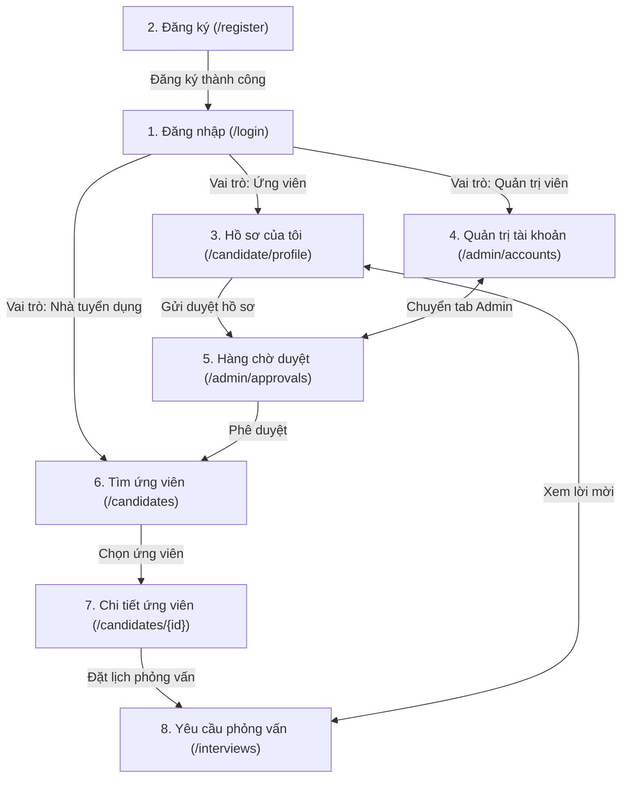
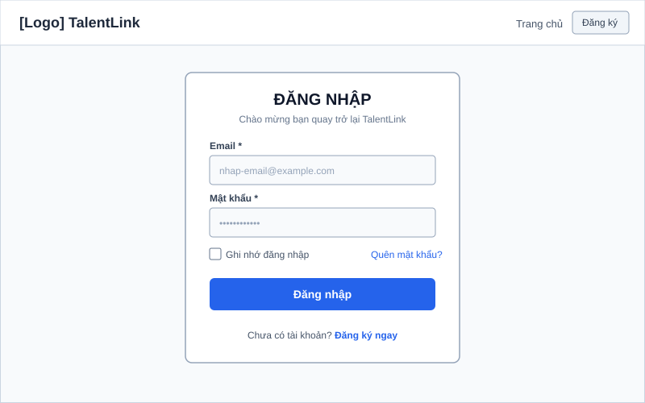
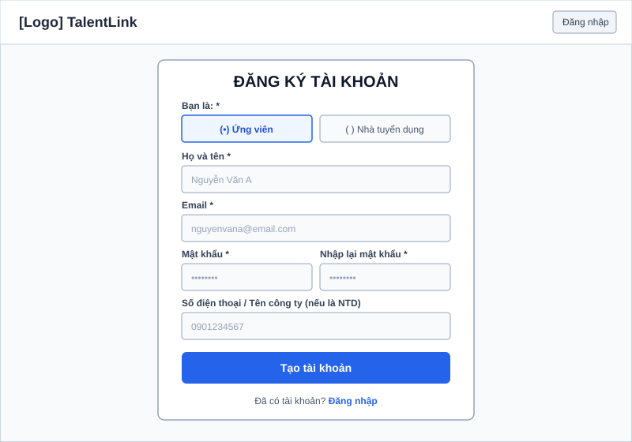
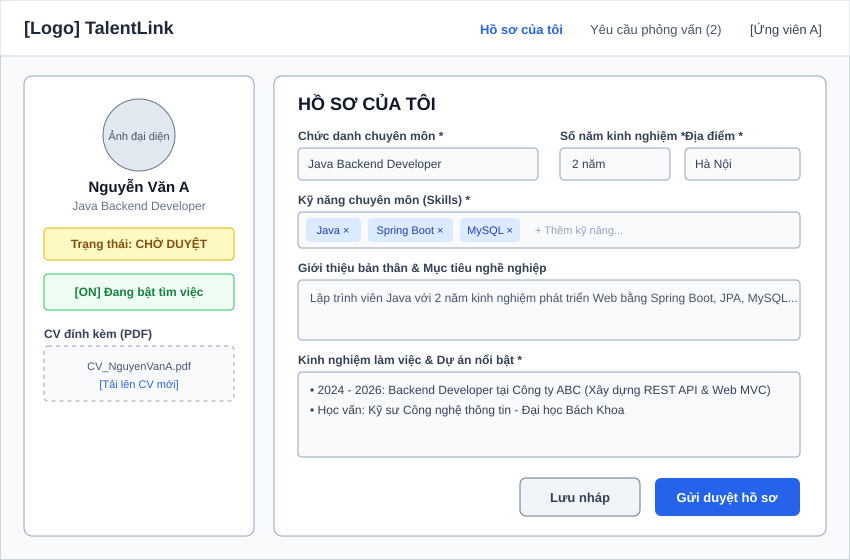
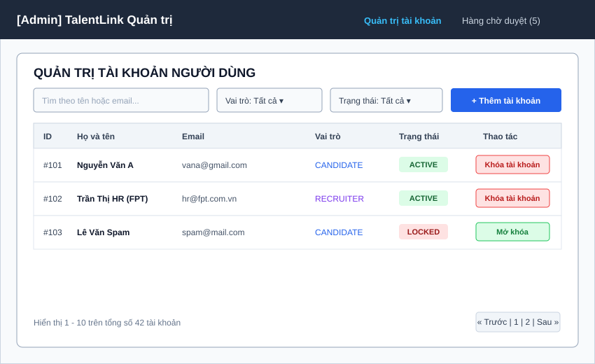
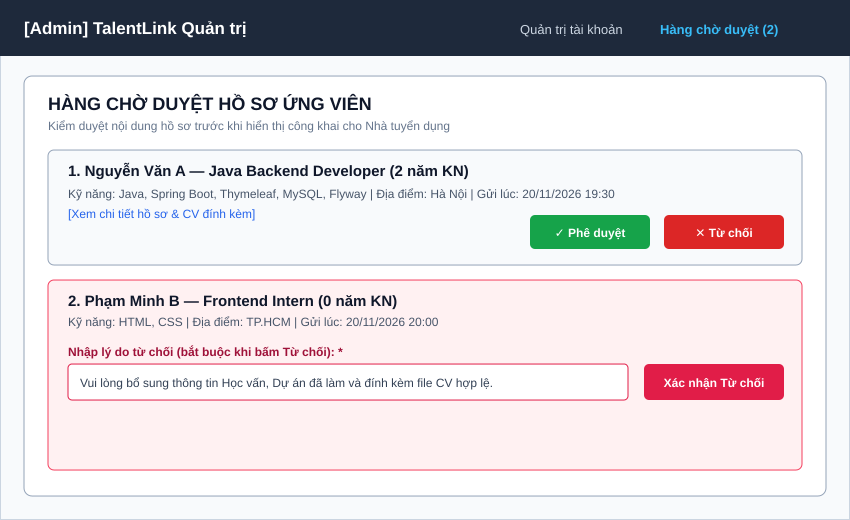
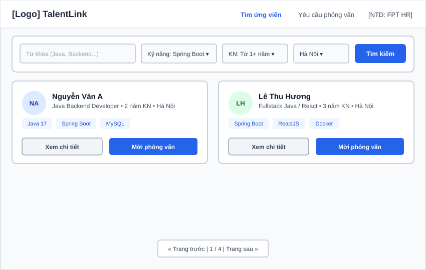
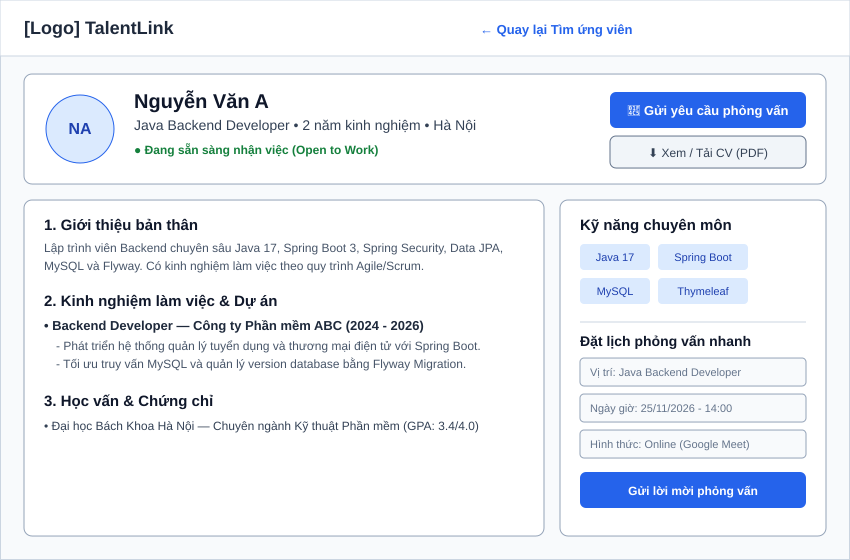
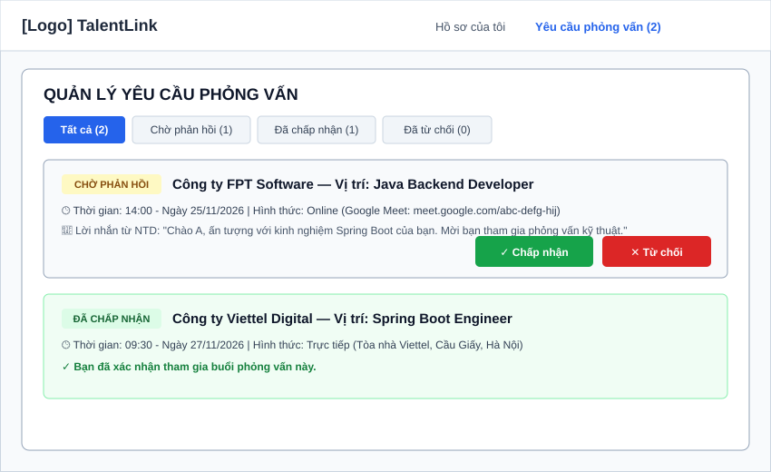

# Thiết kế Wireframe các màn hình chính — TalentLink

**Mã Task:** `T4E7A9A`  
**Danh sách 8 màn hình chính:**
1. [Màn hình Đăng nhập (`/login`)](#1-màn-hình-đăng-nhập-login)
2. [Màn hình Đăng ký (`/register`)](#2-màn-hình-đăng-ký-register)
3. [Màn hình Hồ sơ của tôi (`/candidate/profile`)](#3-màn-hình-hồ-sơ-của-tôi-candidateprofile)
4. [Màn hình Quản trị tài khoản (`/admin/accounts`)](#4-màn-hình-quản-trị-tài-khoản-adminaccounts)
5. [Màn hình Hàng chờ duyệt (`/admin/approvals`)](#5-màn-hình-hàng-chờ-duyệt-adminapprovals)
6. [Màn hình Tìm ứng viên (`/candidates`)](#6-màn-hình-tìm-ứng-viên-candidates)
7. [Màn hình Chi tiết ứng viên (`/candidates/{id}`)](#7-màn-hình-chi-tiết-ứng-viên-candidatesid)
8. [Màn hình Yêu cầu phỏng vấn (`/interviews`)](#8-màn-hình-yêu-cầu-phỏng-vấn-interviews)

---

## Sơ đồ luồng điều hướng màn hình (Screen Flow)

---

## 1. Màn hình Đăng nhập (`/login`)

### Hình ảnh Wireframe

### Thành phần giao diện & Hành vi
- **Input Email (`username`):** Bắt buộc, kiểm tra định dạng email.
- **Input Mật khẩu (`password`):** Bắt buộc, kiểu `password`.
- **Checkbox Ghi nhớ đăng nhập (`remember-me`):** Duy trì phiên đăng nhập.
- **Nút `Đăng nhập`:** Gửi `POST /login` qua Spring Security, điều hướng theo vai trò (`CANDIDATE` -> Hồ sơ của tôi, `RECRUITER` -> Tìm ứng viên, `ADMIN` -> Quản trị tài khoản).

---

## 2. Màn hình Đăng ký (`/register`)

### Hình ảnh Wireframe

### Thành phần giao diện & Hành vi
- **Radio chọn Vai trò:** `Ứng viên (CANDIDATE)` hoặc `Nhà tuyển dụng (RECRUITER)`.
- **Các trường dữ liệu:** Họ và tên (`@NotBlank`), Email (`@Email`), Mật khẩu (`@Size(min = 8)`), Nhập lại mật khẩu, Số điện thoại / Tên công ty.
- **Nút `Tạo tài khoản`:** Lưu tài khoản mới với mật khẩu mã hóa BCrypt và chuyển sang `/login`.

---

## 3. Màn hình Hồ sơ của tôi (`/candidate/profile`)

### Hình ảnh Wireframe

### Thành phần giao diện & Hành vi
- **Cột trái (Thông tin tóm tắt):** Ảnh đại diện, Họ tên, Nhãn trạng thái duyệt hồ sơ (`NHÁP`, `CHỜ DUYỆT`, `ĐÃ DUYỆT`, `BỊ TỪ CHỐI`), Nút gạt bật/tắt `Đang bật tìm việc`, Khu vực tải lên file CV (`.pdf`).
- **Cột phải (Form chi tiết):** Chức danh chuyên môn, Số năm kinh nghiệm, Địa điểm làm việc, Thẻ Kỹ năng (Skills tags), Giới thiệu bản thân, Kinh nghiệm làm việc & Học vấn.
- **Nút `Lưu nháp` & `Gửi duyệt hồ sơ`:** Lưu thông tin hoặc đẩy hồ sơ sang **Hàng chờ duyệt** của Admin.

---

## 4. Màn hình Quản trị tài khoản (`/admin/accounts`)

### Hình ảnh Wireframe

### Thành phần giao diện & Hành vi
- **Thanh công cụ lọc:** Tìm kiếm theo tên/email, lọc theo Vai trò (`CANDIDATE`, `RECRUITER`, `ADMIN`), lọc theo Trạng thái (`ACTIVE`, `LOCKED`), nút `+ Thêm tài khoản`.
- **Bảng danh sách tài khoản:** Hiển thị ID, Họ tên, Email, Vai trò, Trạng thái và nút thao tác **`Khóa tài khoản`** / **`Mở khóa`**.

---

## 5. Màn hình Hàng chờ duyệt (`/admin/approvals`)

### Hình ảnh Wireframe

### Thành phần giao diện & Hành vi
- **Danh sách hồ sơ chờ duyệt (`PENDING_APPROVAL`):** Hiển thị thông tin ứng viên, kỹ năng, thời điểm gửi duyệt và link xem nhanh toàn bộ hồ sơ/CV.
- **Nút `✓ Phê duyệt`:** Chuyển trạng thái hồ sơ sang `APPROVED` để hiển thị trên trang **Tìm ứng viên**.
- **Nút `✕ Từ chối`:** Mở ô bắt buộc nhập **Lý do từ chối** và chuyển trạng thái hồ sơ sang `REJECTED`.

---

## 6. Màn hình Tìm ứng viên (`/candidates`)

### Hình ảnh Wireframe

### Thành phần giao diện & Hành vi
- **Thanh tìm kiếm & bộ lọc:** Ô nhập từ khóa, Dropdown chọn Kỹ năng (Java, Spring Boot, React...), Số năm kinh nghiệm, Khu vực/Địa điểm.
- **Lưới thẻ ứng viên (Candidate Cards):** Hiển thị các ứng viên đã được duyệt (`APPROVED`), gồm Tên, Chức danh, Số năm KN, Địa điểm, các thẻ Kỹ năng, nút **`Xem chi tiết`** và **`Mời phỏng vấn`**.

---

## 7. Màn hình Chi tiết ứng viên (`/candidates/{id}`)

### Hình ảnh Wireframe

### Thành phần giao diện & Hành vi
- **Header hồ sơ:** Thông tin ứng viên, trạng thái sẵn sàng nhận việc, nút xem/tải CV đính kèm và nút **`Gửi yêu cầu phỏng vấn`**.
- **Nội dung hồ sơ chi tiết:** Giới thiệu bản thân, Kinh nghiệm làm việc & Dự án thực tế, Học vấn & Chứng chỉ, Danh sách kỹ năng.
- **Khung Đặt lịch phỏng vấn nhanh:** Cho phép Nhà tuyển dụng nhập Vị trí, Ngày giờ, Hình thức (`Online`/`Offline`), Link/Địa điểm và gửi lời mời ngay trên trang.

---

## 8. Màn hình Yêu cầu phỏng vấn (`/interviews`)

### Hình ảnh Wireframe

### Thành phần giao diện & Hành vi
- **Tab lọc trạng thái:** `Tất cả`, `Chờ phản hồi (PENDING)`, `Đã chấp nhận (ACCEPTED)`, `Đã từ chối (DECLINED)`.
- **Danh sách thẻ Yêu cầu phỏng vấn:** Hiển thị tên Công ty / Ứng viên, Vị trí tuyển dụng, Ngày giờ phỏng vấn, Hình thức & Link/Địa điểm, Lời nhắn.
- **Thao tác theo vai trò:**
  - **Ứng viên:** Bấm **`✓ Chấp nhận`** hoặc **`✕ Từ chối`** đối với yêu cầu đang chờ phản hồi.
  - **Nhà tuyển dụng:** Theo dõi trạng thái phản hồi của ứng viên hoặc hủy lời mời khi đang chờ.
